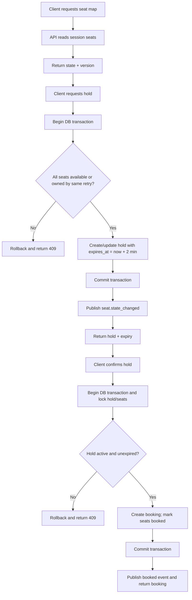
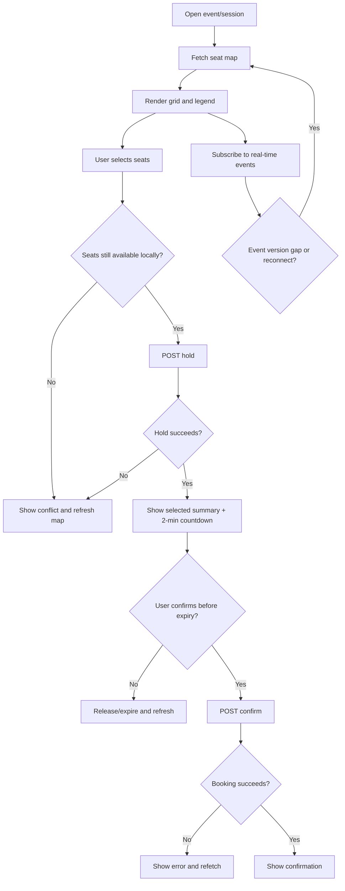
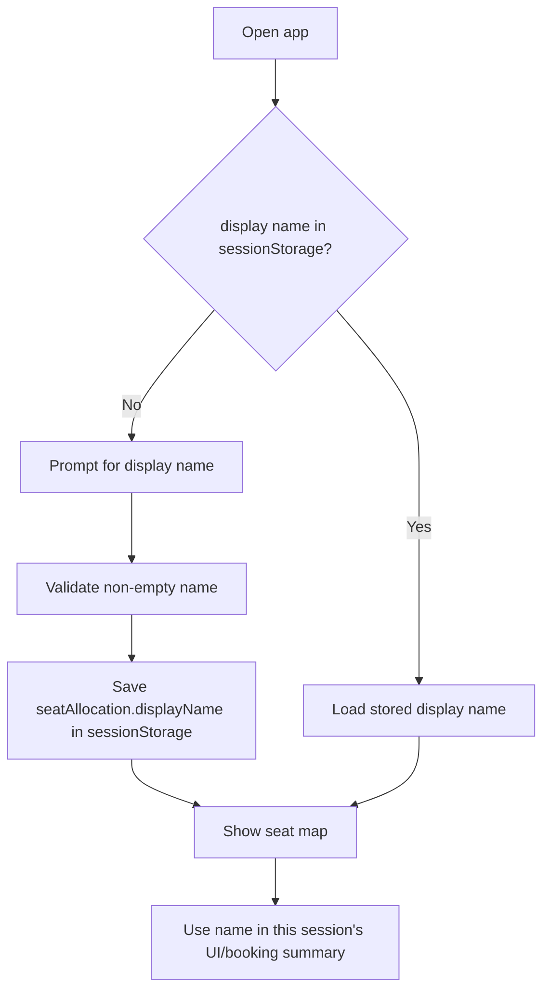

# Seat Allocation — Backend and Frontend Flows

## Backend flow

## Frontend flow

## Suggested contiguous-seat behavior

1. When a user selects a starting seat, inspect the same row/section for a contiguous run.
2. Suggest the smallest run that satisfies the requested count, preferring the same price tier.
3. Treat suggestions as hints only; the backend remains authoritative.

## Blocked-seat timer behavior

For a seat held by another user, render a blocked state and countdown using the server's `heldUntil` value. When the timer reaches zero, refetch the seat state; do not assume the seat is available until the backend confirms it.

## Phase 1 visitor-name flow

